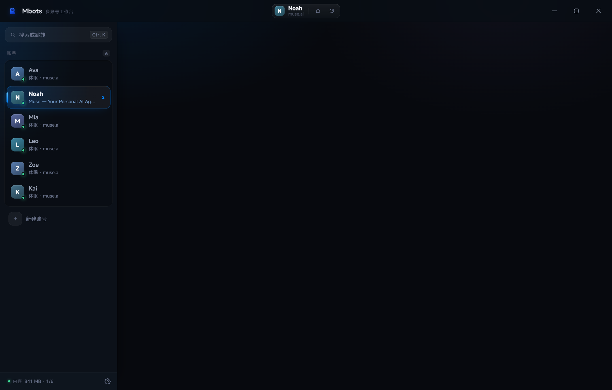
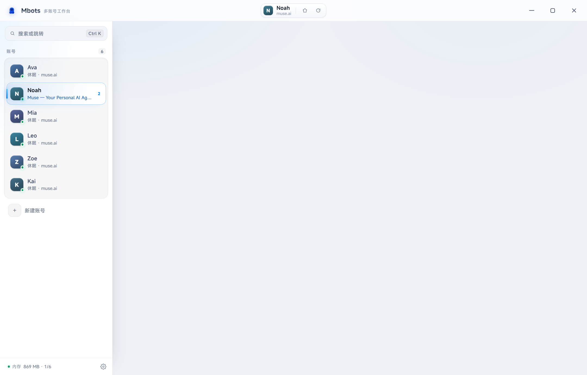

# Mbots

**muse.ai 多账号工作台。** 每个账号跑在独立的会话分区里，登录一次永久记住，侧栏点一下就能换号——不用退出、不用重新收验证码。

| 深色 | 浅色 |
|---|---|
|  |  |

> 截图为虚构账号数据，账号名与头像均为示意。右侧浅色区域是当前账号的网页视图。当前版本 **v1.0.1**，见 [Releases](../../releases)。

---

## 为什么做这个

muse.ai 本身没有账号切换，多号党只能反复退出登录、收验证码、重新登录。Mbots 把每个账号放进独立的 `session` 分区，cookie 物理隔离，切换只是一个视图切换的动作，1 秒内完成，登录态互不干扰。

常见做法是开多个浏览器用户目录、再给每个目录做个快捷方式——本质还是"多窗口"。Mbots 是**单窗口 + 侧栏切换**，像 Telegram 切号那样。

## 安装

从 [Releases](../../releases) 下载 `Mbots-Setup.exe`，双击安装。

- 装到当前用户目录，**不需要管理员权限**
- 装完桌面和开始菜单都有入口，右上角关闭按钮可设置为「最小化到托盘」，继续后台运行
- 仅支持 Windows x64

## 用法

| 操作 | 快捷键 |
|---|---|
| 切换账号 | 点侧栏，或 `Ctrl + 1…9` |
| 命令面板 | `Ctrl + K` |
| 新建账号 | `Ctrl + T` |
| 刷新当前页 | `Ctrl + R` |
| 打开设置 | `Ctrl + ,` |

- **改名**：双击账号名，回车确认
- **右键账号**：刷新 / 回首页 / 休眠 / 删除
- **顶栏胶囊**：显示当前账号和域名，里面两个按钮是回首页和刷新
- **右上角 ×**：默认先问一句——「最小化到托盘」继续后台运行，「退出 Mbots」结束所有进程；可在设置里改默认动作
- **托盘图标**：单击恢复窗口；右键可休眠全部账号或退出

首次使用：点「新建账号」→ 输入邮箱 → 收验证码 → 登录。**之后这个账号就不用再登录了**。

## 内存与 CPU

多账号应用最容易翻车的地方是内存。这里做了三件事：

**1. 启动时只加载当前账号。**
后台账号默认不启动渲染进程，用的时候才加载。4 个账号不等于 4 个常驻渲染进程。

**2. 闲置自动休眠。**
非当前账号闲置超过设定时间后，整个渲染进程被销毁，只保留 cookie 和最后的地址。切回去时重新加载那一页——登录态还在，不用验证码。窗口最小化时，所有后台账号立即休眠。

**3. 后台降频。**
所有页面开启 Chromium 的 `backgroundThrottling`，隐藏时定时器和动画自动降到低频。

实测（1 个账号加载 muse.ai 会话页 + 3 个账号休眠）：

```
内存  ~760 MB      进程  6 个
CPU   单核 2.5%    整机 0.10%
```

侧栏底部会实时显示当前占用和「几比几在跑」。想立刻释放，`Ctrl+K` → 「休眠所有后台账号」。

每个活跃账号大约 250–350 MB，取决于页面本身。这是 Chromium 的固有成本，不是应用层的开销。

## 设置

点侧栏右下角齿轮，或 `Ctrl + ,`。

**外观**

| 项 | 说明 |
|---|---|
| 主题 | 浅色 / 深色 / 跟随系统；跟随系统时随 Windows 实时切换 |
| 强调色 | 默认 muse 品牌蓝，另有深蓝 / 天青 / 靛 / 翡翠 / 玫红 |
| 字号 | 小 / 中 / 大 |
| 紧凑模式 | 隐藏副标题、收窄行高，一屏能多放 30% 账号 |
| 界面动效 | 关掉后切换更硬朗，也更省一点电 |

**行为**

| 项 | 说明 |
|---|---|
| 后台休眠 | 1 / 5 / 15 分钟或永不。闲置超时后销毁后台渲染进程 |
| 关闭按钮 | 点右上角 × 时：先问我（弹出「最小化到托盘 / 退出」）/ 最小化 / 直接退出 |
| 开机自启动 | 走系统登录项，不写计划任务 |

**数据**

- **本地缓存**：显示当前占用，点「清理」只清 HTTP 缓存与 shadercache，**不动 cookie**，登录态不受影响
- **全部账号休眠**：立刻释放所有后台渲染进程

设置存在 `%APPDATA%\Mbots\settings.json`，改完即时生效。

## 界面

- **字体**：内嵌 MiSans 可变字体（4.6 MB，56 个分片按需加载），不依赖系统雅黑
- **配色**：取自 muse.ai 官方 logo 的品牌蓝渐变 `#0082FB → #0064E0 → #0040DC`；选中态、头像、光晕都在同一色系
- **主题**：浅色 / 深色两套完整令牌（半透明层、描边、阴影各有一套），跟随系统时用 `nativeTheme` 实时同步
- **图标**：按 muse 的蓝色毛绒小怪物重绘——圆头、宽肚、两只小短脚、深蓝脸盘，肚子上一个奶油色手写 M；矢量分尺寸渲染（16–256 共 7 档）
- **窗口按钮**：标题栏完全自绘，右上角最小化 / 最大化 / 关闭——52×40 圆角块配 18px 线性图标，悬停浮出底色，关闭键变红，按下轻微回缩
- **尺寸**：标题栏 52px，侧栏 276px，右侧网页区由 `WebContentsView` 原生承载
- **账号卡**：低饱和莫兰迪色头像 + 状态点（绿在跑 / 黄需登录 / 蓝加载中）+ 选中态发光边条

## 数据在哪

```
%APPDATA%\Mbots\
  accounts.json          账号列表（名称、分区、最后地址）
  settings.json          外观与行为设置
  Partitions\muse-acc*   每个账号独立的 cookie / 存储
```

**备份就是复制这个目录。** 想彻底清空某个账号，右键删除即可（会清掉它的存储）。

## 开发

```bash
npm install
npm start          # 开发模式
npm run build      # 打包到 dist/
```

技术栈：Electron 33 + `WebContentsView`（每个账号一个 `session.fromPartition`）+ 原生渲染层自绘 UI，无前端框架。

```
main.js              主进程：会话分区、视图调度、休眠策略、设置持久化、托盘
preload.js           IPC 桥（window.mbots）
renderer/            标题栏 + 侧栏 + 命令面板 + 设置抽屉
icon.html            SVG 源，render-icon.js 逐尺寸栅格化，make-icon.js 打包 ICO
```

## 已知限制

- **验证码还得手动收一次。** 应用没有邮箱访问权，做不到无人值守登录。
- **同一账号不能多开。** 一个账号一个分区，重复添加没意义。
- **只针对 muse.ai。** 首页地址写死为 `https://muse.ai/`，换成别的站点能跑但没有针对性适配。
- **占内存取决于页面。** muse.ai 的会话页偏重，开视频页会更高。

## 更新日志

**v1.0.1** — 放大右上角窗口控制按钮：图标 11px → 18px、按钮改为 52×40 圆角块、三者间距收紧；README 补深色 / 浅色两张界面截图。

**v1.0.0** — 首个公开版本。

## 许可

MIT
